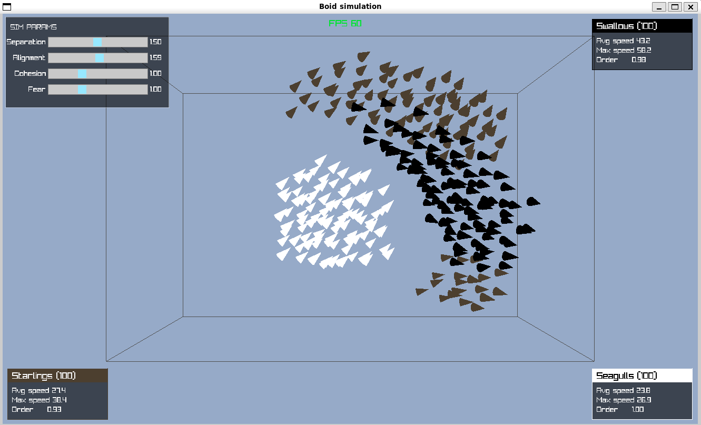

# Flocking Behaviour Simulation (Boids)


**Author:** Lucia Galli  
**Date:** 04/07/2026

## 1. Project Description
A real-time 3D simulation of collective animal behaviour inspired by
Craig Reynolds' Boids model.

The project extends the classical flocking model with:

- Multiple coexisting species
- Predator-prey interactions
- Fear-driven behavioural dynamics
- Runtime parameter tuning via GUI
- Behavioural metrics and flock polarization analysis

Each boid computes its trajectory according to three local interaction rules:

- **Separation:** short-range repulsion to avoid collisions.
- **Alignment:** tendency to match the average velocity direction of neighbouring conspecifics.
- **Cohesion:** attraction towards the local centre of mass of neighbouring conspecifics.

A danger-avoidance rule is also applied, both with respect to the simulation boundaries (walls) and predator agents.

| Species | Colour | Max Speed |
|----------|----------|----------|
| **Swallow** | Black | 105 |
| **Starling** | Brown | 65 |
| **Seagull** | White | 60 |

Technologies:
C++17, Raylib, Raygui, CMake, Doctest

### Architectural Evolution

The project initially consisted of a 2D simulation with static obstacles and a user-controlled predator. To increase physical realism and the richness of emergent behaviours, the simulation was migrated to a 3D environment. This made manual predator control impractical, so obstacles were reduced to the bounding walls of the simulation volume. Using polymorphism, Seagulls were implemented as autonomous predator agents, substantially increasing the realism of the ecosystem.

### Highlights

- Real-time 3D flocking simulation
- Three interacting species
- Predator-prey dynamics
- Fear-driven avoidance behaviour
- Runtime parameter tuning
- Automated testing using doctest
- C++17, Raylib, CMake

## 2. Main Design and Implementation Choices

### 2.1 File Structure

| File | Purpose |
|------|---------|
| `vec3.hpp` | `Vec3` structure and vector algebra utilities |
| `configs.hpp` | Global constants and configuration parameters |
| `boid.hpp` / `boid.cpp` | Abstract `Boid` class and Reynolds model implementation |
| `swallow.*`, `starling.*`, `seagull.*` | Species-specific implementations |
| `danger.hpp` | Abstract `Danger` interface |
| `wall.hpp` | Boundary representation implementing `Danger` |
| `engine.hpp` / `engine.cpp` | Main loop, rendering and GUI |
| `utils.cpp` | Utility functions and Raylib conversions |
| `main.cpp` | Application entry point |
| `test_vec3.cpp` | Linear algebra tests |
| `test_boid.cpp` | Behavioural and collision tests |

### 2.2 Vec3

`Vec3` represents vectors in Euclidean space and provides overloaded arithmetic operators together with helper functions for norms, normalisation, dot products and distances. Squared distances are preferred whenever possible to avoid unnecessary square root computations.

### 2.3 Species Hierarchy

`Boid` stores position, velocity, orientation and Reynolds' algorithm. `Swallow`, `Starling` and `Seagull` specialise the base class through species-specific parameters.

`Seagull` uses multiple inheritance: it is both a `Boid` and a `Danger`, allowing prey species to recognise it as a predator.

### 2.4 Steering Model

The core of the simulation is `Boid::evolve`, which:

1. Analyses neighbours and distances.
2. Computes steering forces.
3. Applies obstacle and predator avoidance.
4. Combines forces and integrates acceleration.

A double-buffer approach is adopted: `evolve()` computes accelerations without modifying state, while `apply()` updates the entire population afterwards.

### 2.5 Space Topology

The simulation domain is a rectangular box centred at the origin. A reduced Z dimension improves both rendering and interaction density. Toroidal boundary conditions (`apply_wrap`) are used, while walls generate repulsive fields that keep agents inside the environment.

### 2.6 Smoothed Orientation

Visual heading is filtered using frame-rate-independent exponential smoothing to avoid abrupt orientation changes during rapid manoeuvres.

### 2.7 Random Generation

Initial positions and directions are generated through C++11 random facilities (`std::random_device`, `std::default_random_engine`, `std::uniform_real_distribution`).

### 2.8 Runtime Interface

- Population setup menu.
- Runtime sliders for Reynolds coefficients.
- HUD displaying FPS, speed statistics and an Order Parameter measuring flock polarisation.

### 2.9 Advanced Features

- `dynamic_cast`-based predator recognition.
- C++17 inline variables.
- Squared-distance optimisation.

## 3. Testing Strategy

The project uses **doctest**.

### `test_vec3`

- Arithmetic operators.
- Normalisation behaviour.
- Dot products and distances.

### `test_boid`

- Boundary confinement.
- Separation.
- Alignment and cohesion.
- Inertial motion.
- Wall projection geometry.

Tests follow the same `evolve()` → `apply()` workflow used by the engine.

## 4. External Libraries

The only external dependency is **raylib**. `raygui` is included directly in the source tree.

### Installation

The project requires:

- CMake >= 3.16
- A C++17 compatible compiler
- A system installation of raylib discoverable through `find_package(raylib REQUIRED)`

### Build

```bash
cmake -S . -B build -G"Ninja Multi-Config"
cmake --build build --config Debug
cmake --build build --config Debug --target test
cmake --build build --config Release
cmake --build build --config Release --target test
```

### Run

```bash
./build/Release/game
# or
./build/Debug/game
```

### Run Tests

```bash
ctest --test-dir build --build-config Debug --output-on-failure
ctest --test-dir build --build-config Release --output-on-failure
```

## 5. Inputs and Outputs

### Inputs

- Species populations.
- Reynolds coefficients in the range `[0.0, 3.0]`.

The engine prevents simulations with more than 600 boids to preserve performance and readability.

### Outputs

Real-time 3D visualisation with telemetry, statistics and behavioural metrics.

## 6. Results

Default parameters generate stable emergent flocking behaviour from random initial conditions.

- Increased cohesion reduces spatial variance.
- Increased separation produces more dispersed flocks.
- The Order Parameter approaches `1` for coherent motion and `0` for highly disordered states.
- Predator-prey interactions remain visible due to species-specific alignment.

